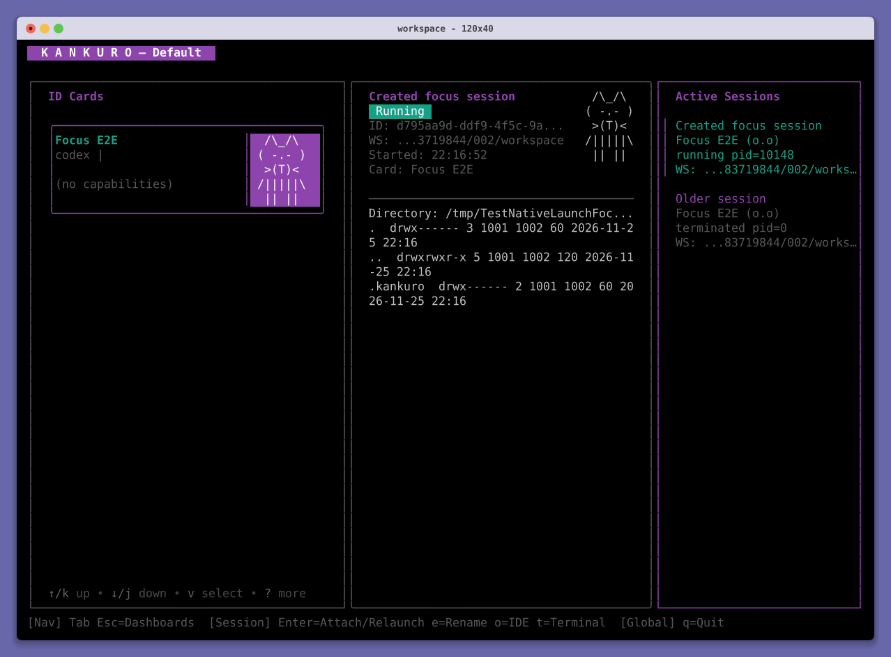
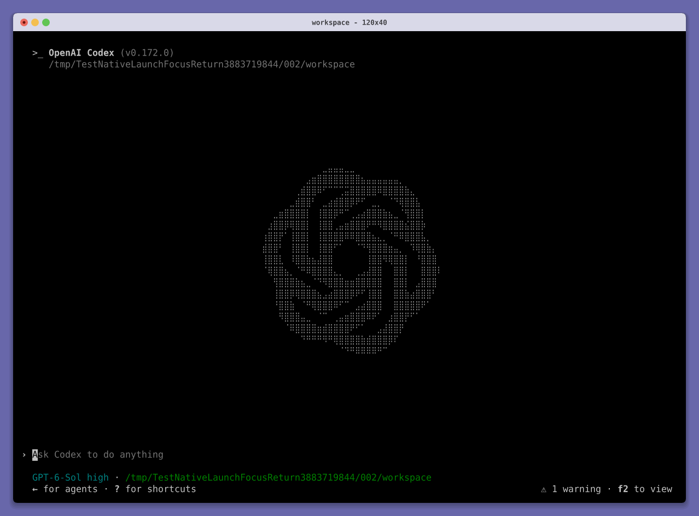

# KANKURO

KANKURO is a terminal app for running and coordinating AI coding agents such as
Codex and Claude Code. Run sessions yourself, let an orchestrator coordinate
them through Kankuro's built-in MCP server, or combine both in one dashboard.
You choose the agents, tasks, and handoffs for each workflow.



## Run agents by hand or delegate coordination

- **Work in the native CLI.** Launch or attach to an agent from the dashboard
  and use its usual commands and shortcuts. Press `Ctrl+K` to return to
  Kankuro while the agent keeps running. Kankuro adds shortcuts to switch
  between sessions and open a session's workspace in your IDE or terminal.
- **Let an orchestrator coordinate sessions.** Select Kankuro MCP on the
  orchestrator's card and enable Dashboard Control so it can launch sessions,
  send tasks, and retrieve worker reports within its dashboard. Select Kankuro
  MCP on worker cards so they can report back. For example, OpenCode can create
  a session and assign an implementation to Codex, then send a Claude Code
  agent to review the changes after Codex reports back. You can attach to any
  live orchestrated session at any time and take over in its native CLI.



## Organize dashboards, workspaces, and skills

- **Dashboards** group agent templates and sessions. Use separate dashboards
  for different projects, teams, or automated workflows. Each dashboard sets
  the scope for its orchestrators' session control.
- **Agent cards** save reusable launch settings, including the CLI, model,
  workspace, instructions, skills, and MCP servers.
- **Source directories** supply the workspace and skill registries. Register
  a single workspace or a parent directory whose immediate subdirectories
  become selectable workspaces. Point skill sources at directories you maintain
  and select the discovered skills on each card. Run an agent in the original
  workspace or in a temporary copy.

## Install

Requires Go **1.27.3**. The Go command's default `GOTOOLCHAIN=auto` behavior can
automatically download and select the version required by this module.

```bash
go install github.com/BlackGiack/kankuro@latest
```

Go installs the executable into `GOBIN`, or the default Go bin directory when
`GOBIN` is unset. Add that directory to `PATH` to run `kankuro`.

## Local development

From the repository root:

```bash
go run .
go build .
go install .
```

For a manual run, isolate the app's data from your real user configuration:

```bash
KANKURO_TMP_DIR=/tmp/kankuro-test/tmp \
KANKURO_CONFIG_DIR=/tmp/kankuro-test/config \
  go run .
```

An empty config directory initializes automatically. Existing configurations must
use the current dashboard format; startup rejects incomplete or unsupported
layouts without converting them. Use a dedicated config directory rather than a
folder containing build or review artifacts.
